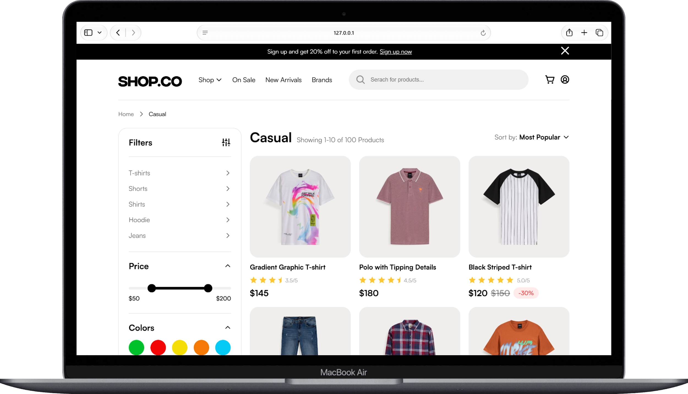
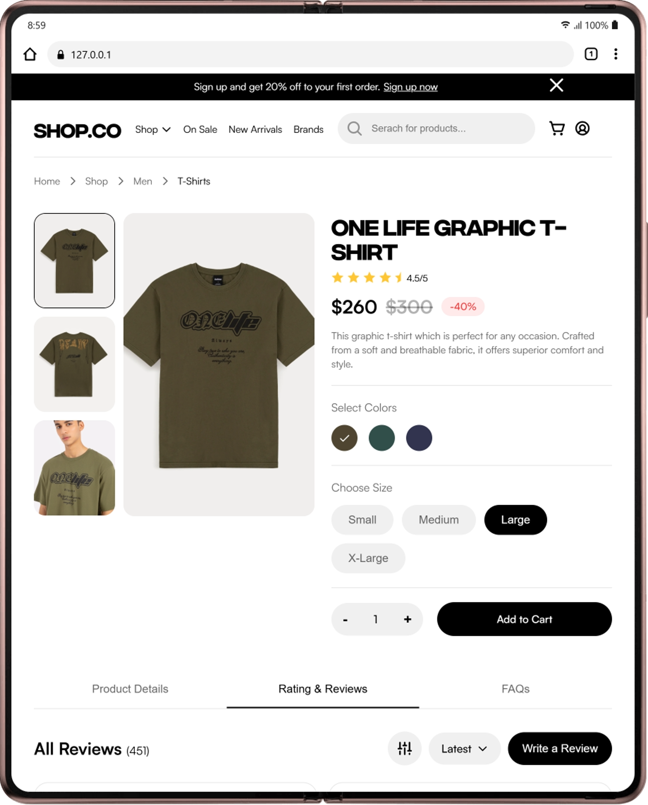
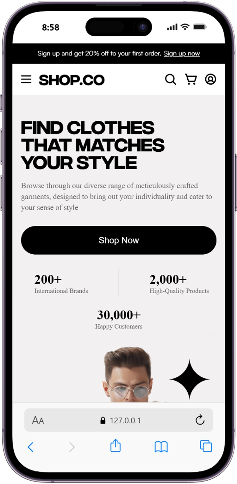
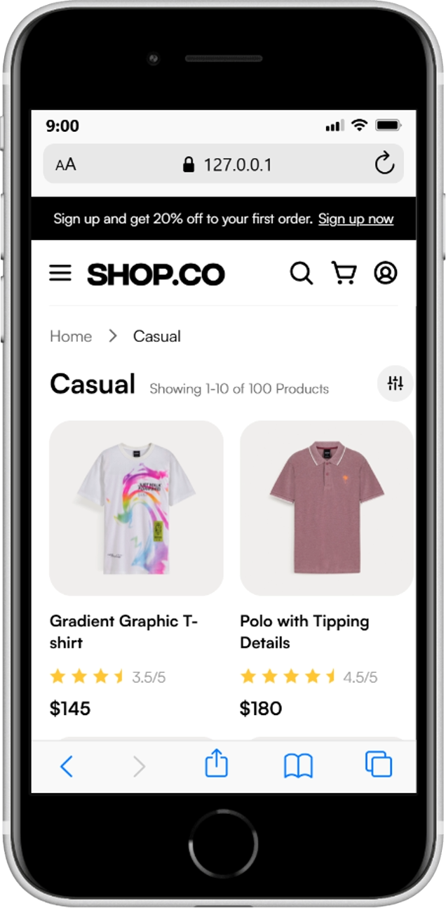
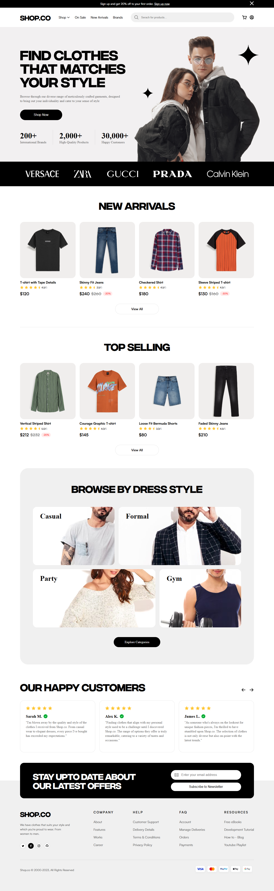
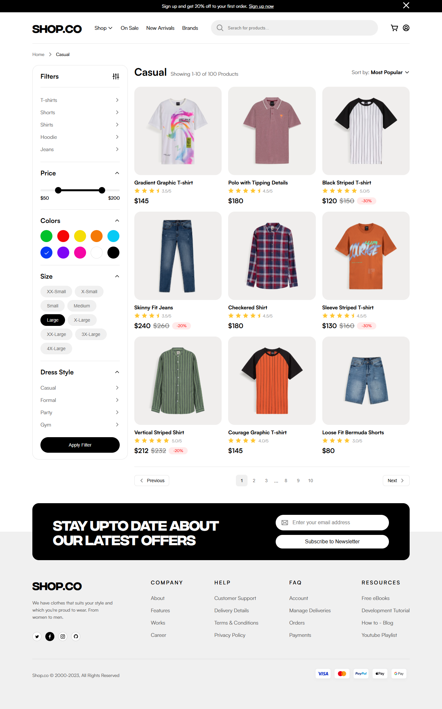
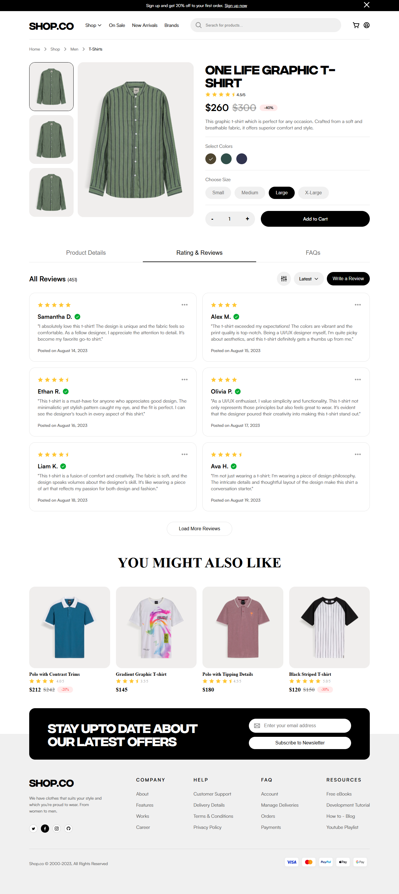
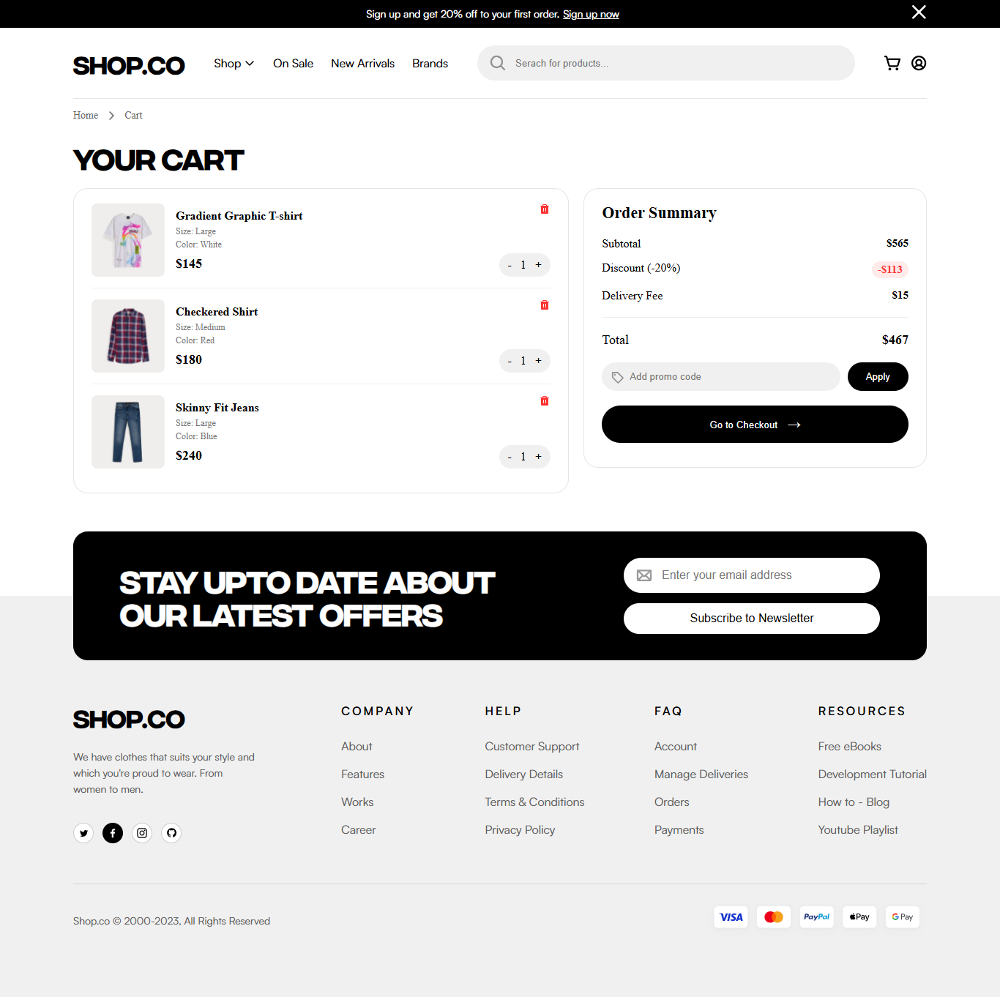

# 🛍️ SHOP.CO — E-Commerce Fashion Web Application

<p align="left">
  <a href="https://developer.mozilla.org/en-US/docs/Web/HTML"></a>
  <a href="https://developer.mozilla.org/en-US/docs/Web/CSS"></a>
  <a href="https://github.com/"></a>
  <a href="https://vercel.com/"></a>
  <a href="https://code.visualstudio.com/"></a>
</p>

**SHOP.CO** is a modern, responsive, pixel-perfect e-commerce fashion web application built from Figma design specifications. It provides a complete online shopping experience including a dynamic homepage, an advanced product category filtering catalog, an interactive product detail showcase, and a full-featured shopping cart with order summary calculations.

---

## 📱 Fully Responsive Across All Devices

> Perfectly crafted and optimized for all screen sizes — ensuring no elements are cropped, squeezed, or misplaced.

### 💻 Desktop / Laptop (MacBook Air)
<p align="center">
  <a href="Readme-Images/Macbook-Air-127.0.0.1.png">
    
  </a>
</p>

### 📱 Tablet & Mobile Previews

<table>
  <tr>
    <th align="center" width="46%">📱 Tablet / Foldable (Galaxy Fold 2)</th>
    <th align="center" width="27%">📱 Modern Mobile (iPhone 14 Pro)</th>
    <th align="center" width="27%">📱 Compact Mobile (iPhone SE)</th>
  </tr>
  <tr>
    <td align="center" valign="top">
      <a href="Readme-Images/Galaxy-Fold2-127.0.0.1.png">
        
      </a>
    </td>
    <td align="center" valign="top">
      <a href="Readme-Images/iPhone-14-PRO-127.0.0.1.png">
        
      </a>
    </td>
    <td align="center" valign="top">
      <a href="Readme-Images/iPhone-SE-2016-127.0.0.1.png">
        
      </a>
    </td>
  </tr>
</table>

---

## 📑 Table of Contents

<details>
<summary><b>Click to expand / collapse</b></summary>
<br>

- [📱 Fully Responsive Across All Devices](#-fully-responsive-across-all-devices)
- [✨ Key Features](#-key-features)
- [📸 Screenshots & Page Previews](#-screenshots--page-previews)
  - [1. Home Page](#1-home-page)
  - [2. Product Categories Page](#2-product-categories-page)
  - [3. Product Details Page](#3-product-details-page)
  - [4. Shopping Cart Page](#4-shopping-cart-page)
- [💻 Tech Stack & Tools](#-tech-stack--tools)
- [📁 Folder & Project Structure](#-folder--project-structure)
- [📱 Responsive Design & Breakpoints](#-responsive-design--breakpoints)
- [🚀 Getting Started](#-getting-started)
- [🎨 Design Highlights & Micro-interactions](#-design-highlights--micro-interactions)
- [👨‍💻 Author](#-author)
- [📄 License](#-license)

</details>

---

## ✨ Key Features

- **Full E-Commerce User Flow:** Seamless navigation between Home, Category Catalog, Product Detail View, and Shopping Cart.
- **Pixel-Perfect Responsive Layout:** Fully adaptive layouts tailored for mobile devices (320px+), tablets, desktop screens, and ultra-wide 1920px/1980px monitors.
- **Interactive Visual Feedback:**
  - Smooth image hover-zoom effects (`scale(1.08)`) with enclosed rounded card corners (`overflow: hidden`).
  - Active color and size selection states.
  - Interactive breadcrumbs and page redirects.
- **Dual-Range Price Slider:** Custom HTML5 range slider for interactive minimum and maximum price filtering.
- **Dynamic Order Summary:** Real-time visual breakdown of Subtotal, Discount percentage, Delivery fee, and Total price with voucher support.
- **Custom Typography:** Integrated typography featuring **Integral CF** for impactful headings and **Satoshi** for clean, readable body text.

---

## 📸 Screenshots & Page Previews

### 1. Home Page

> Comprehensive storefront showcasing current promotional banners, top brands, new arrivals, trending styles, and verified customer testimonials.

<a href="Readme-Images/homePage.png">
  
</a>

**Highlights:**

- **Top Offer Bar:** Dismissible announcement banner highlighting first-order discounts.
- **Navigation Bar:** Brand logo with instant return link, category links, integrated search bar, mobile search trigger, and direct cart link.
- **Hero Banner:** Dynamic headline, descriptive copy, primary *"Shop Now"* call to action, and live metrics (200+ Brands, 2,000+ Products, 30,000+ Customers).
- **Brand Partner Ribbon:** Logos for Versace, Zara, Gucci, Prada, and Calvin Klein.
- **Product Grids:** Responsive product collections for **New Arrivals** and **Top Selling** with star ratings, pricing, and discount badges.
- **Browse by Dress Style:** Visual discovery grid (Casual, Formal, Party, Gym) featuring an **Explore Categories** direct CTA.
- **Customer Reviews:** Testimonial carousel featuring star ratings, customer names, and verification badges.
- **Newsletter & Footer:** Email capture card and full multi-column navigation with payment gateway badges.

---

### 2. Product Categories Page

> Feature-rich product catalog with comprehensive filtering options and product grid navigation.

<a href="Readme-Images/product-categories.png">
  
</a>

**Highlights:**

- **Collapsible Sidebar Filters:**
  - Multi-category accordions (T-shirts, Shorts, Shirts, Hoodies, Jeans).
  - Dual-thumb price slider with dynamic range indicator.
  - 10-swatch visual color palette with custom selection borders.
  - Size pills ranging from `XX-Small` to `4X-Large`.
  - Dress style selectors and an *"Apply Filter"* submission button.
- **Product Catalog Grid:** 9-card responsive product catalog with star rating indicators, discounted pricing tags, and smooth hover micro-animations.
- **Pagination Component:** Previous, numbered pages, active page styling, and Next buttons.

---

### 3. Product Details Page

> Dedicated single product showcase with multi-angle image gallery, variation selections, and customer reviews.

<a href="Readme-Images/product-details.png">
  
</a>

**Highlights:**

- **Multi-Angle Gallery:** Side-by-side thumbnail previews with a prominent high-resolution display image.
- **Product Configuration:**
  - Real-time pricing display with strike-through original price and styled percentage discount badge (`#FF33331A`).
  - Color variation picker with active state indicators.
  - Size selector pills (`Small`, `Medium`, `Large`, `X-Large`).
  - Quantity counter (`-` / count / `+`) and direct **Add to Cart** action.
- **Tabbed Information Architecture:** Product Details, Rating & Reviews (with review count, sorting dropdown, and review submission button), and FAQs.
- **Related Products:** *"You Might Also Like"* recommendation grid with cross-page navigation.

---

### 4. Shopping Cart Page

> Clean checkout preparation area with order breakdown and voucher redemption.

<a href="Readme-Images/product-cart.png">
  
</a>

**Highlights:**

- **Interactive Cart Items:** Product thumbnail preview, title, selected size & color, item price, quantity increment/decrement controls, and one-click removal action.
- **Order Summary Card:**
  - Itemized cost calculation (Subtotal, Discount, Delivery Fee, Total).
  - Highlighted discount value in accent red text.
  - Promo code input field with *"Apply"* verification button.
  - Primary *"Go to Checkout"* button.

---

## 💻 Tech Stack & Tools

- **Markup:** HTML5 (Semantic elements: `<nav>`, `<section>`, `<article>`, `<aside>`, `<footer>`)
- **Styling:** CSS3 (Modern Flexbox, CSS Grid, Custom Media Queries, Transitions, Transforms)
- **Typography:**
  - **Integral CF** (Headings & Brand Identity)
  - **Satoshi** (Body Copy, Navigation, and Pricing)
- **Icons & Graphics:** Clean Scalable Vector Graphics (SVG) for crisp rendering on high-DPI displays
- **Tools & Deployment:** Visual Studio Code, Git, GitHub, Vercel, Figma

---

## 📁 Folder & Project Structure

```plaintext
ShopCo/
│
├── index.html                 # Homepage (Hero, Brands, New Arrivals, Styles, Reviews)
├── category.html              # Product Catalog & Filtering Page
├── detail.html                # Product Detail & Review Showcase
├── cart.html                  # Shopping Cart & Order Summary Page
├── style.css                  # Unified stylesheet with responsive breakpoints
├── script.js                  # Frontend interactions & scripts
│
├── Icons/                     # Vector graphics, logos, brand emblems, and UI icons
│   ├── arrow-down.svg
│   ├── arrow-left.svg
│   ├── arrow-right.svg
│   ├── banner-mobile.svg
│   ├── banner.svg
│   ├── cart.svg
│   ├── check.svg
│   ├── close-btn.svg
│   ├── delete.svg
│   ├── filter.svg
│   ├── star-4-5.svg
│   └── ... (additional UI icons)
│
├── Readme-Images/             # Device mockups & high-resolution page previews
│   ├── Macbook-Air-127.0.0.1.png       # Desktop view (1280px+)
│   ├── Galaxy-Fold2-127.0.0.1.png      # Tablet / Foldable view
│   ├── iPhone-14-PRO-127.0.0.1.png     # Modern Mobile view
│   ├── iPhone-SE-2016-127.0.0.1.png    # Compact Mobile view
│   ├── homePage.png                    # Full Homepage capture
│   ├── product-categories.png          # Product Catalog capture
│   ├── product-details.png             # Product Details capture
│   └── product-cart.png                # Shopping Cart capture
│
└── README.md                  # Project documentation
```

---

## 📱 Responsive Design & Breakpoints

The application utilizes fluid layout techniques combined with targeted media queries to guarantee an optimal user experience across all screen dimensions:

| Breakpoint | Target Devices | Tested Device Previews | Key Adaptations |
| :--- | :--- | :--- | :--- |
| **`≥ 1400px`** | Ultra-Wide & Large Desktop | Full HD & 2K Monitors | Scaled hero typography (`78px`), expanded container spacing (`100px`) |
| **`≥ 992px – < 1200px`** | Standard Desktops & Laptops | **MacBook Air** | 4-column product grids, split hero layout, side-by-side catalog filter sidebar |
| **`≥ 768px – < 992px`** | Tablets & Foldables | **Galaxy Fold 2** | 2-to-3 column product flow, right-bottom mobile banner placement, compact navbar |
| **`≥ 576px – < 768px`** | Large Phones & Small Tablets | Phablets / Landscape Mobile | Single-column stack, bottom-sheet mobile filter modal, full-width actions |
| **`< 576px`** | Compact Mobile Phones | **iPhone 14 Pro / iPhone SE** | Scaled headers, grid counter, mobile-optimized search, swipeable reviews |

---

## 🚀 Getting Started

Follow these steps to run the project locally on your machine:

1. **Clone the Repository:**

   ```bash
   git clone https://github.com/sajidsam/ShopCo.git
   ```

2. **Navigate to the Project Directory:**

   ```bash
   cd ShopCo
   ```

3. **Open in Browser:**

   - Simply double-click `index.html` to open it in your default web browser, or
   - Use the **VS Code Live Server** extension by right-clicking `index.html` and selecting **"Open with Live Server"**.

---

## 🎨 Design Highlights & Micro-interactions

- **Image Zoom on Hover:** Product cards smoothly zoom (`scale(1.08)`) with a `0.4s ease` transition while remaining cleanly clipped within their `20px` border-radius containers.
- **Accented Discount Badges:** Standardized `#FF33331A` semi-transparent background shading with high-contrast `#FF3333` typography for discount indicators.
- **Custom Dual-Slider:** Native range inputs with custom track and thumb styling matching the brand aesthetic without external library bloat.
- **Mobile Filter Modal:** Touch-friendly bottom-sheet filter modal on mobile with backdrop overlay and quick-close trigger.
- **Smooth Inter-Page Links:** Direct links connect product cards to [detail.html](detail.html), cart icons to [cart.html](cart.html), explore buttons to [category.html](category.html), and brand logos to [index.html](index.html).

---

## 👨‍💻 Author

**Sajidul Islam**
- **GitHub:** [@sajidsam](https://github.com/sajidsam)
- **Email:** [isajidul174@gmail.com](mailto:isajidul174@gmail.com)

---

## 📄 License

This project is open-source and available under the [MIT License](LICENSE).

---

<p align="center">
  Crafted with ❤️ by <b>Sajidul Islam</b> for modern e-commerce web experiences.
</p>
